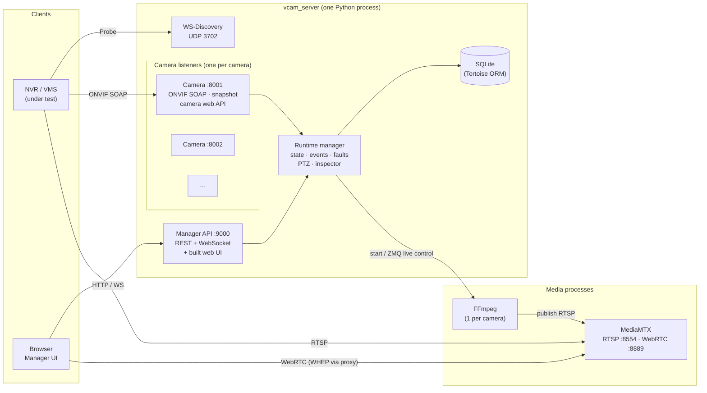

# VirtualCamX

**A farm of 100% software ONVIF IP cameras for testing NVRs.**

VirtualCamX runs on one PC and creates as many virtual IP cameras as you need — 1, 20 or 200.
Each one behaves like a real camera on the network: NVRs find it with *Search devices*
(WS-Discovery), log in with ONVIF, pull RTSP video, receive motion/alarm events, move its PTZ,
change its image settings — and can't tell it apart from hardware.

You control the whole farm from a web console: create cameras from templates, feed them your own
video footage, fire events, break cameras on purpose (go offline, drop the stream, change the
password…), and watch every ONVIF request your NVR sends.

```
 ┌──────────────┐  WS-Discovery / ONVIF / RTSP   ┌──────────────────────────────┐
 │  NVR / VMS   │ ◀────────────────────────────▶ │  VirtualCamX (one PC)        │
 │  under test  │                                │  Gate-1  :8001  ┐            │
 └──────────────┘                                │  Gate-2  :8002  │ 1…N virtual│
 ┌──────────────┐  Web UI (React)                │  Yard-PTZ:8003  │ cameras    │
 │   Browser    │ ◀────────────────────────────▶ │  …              ┘            │
 └──────────────┘                                └──────────────────────────────┘
```

---

## Contents

- [Why](#why)
- [Features](#features)
- [Architecture](#architecture)
- [How it works](#how-it-works)
- [Project layout](#project-layout)
- [Requirements](#requirements)
- [Getting started](#getting-started)
- [Docker](#docker)
- [Using it with an NVR](#using-it-with-an-nvr)
- [Ports](#ports)
- [Configuration](#configuration)
- [Theming the web UI](#theming-the-web-ui)
- [Development](#development)
- [Testing](#testing)
- [Status & roadmap](#status--roadmap)
- [Documentation](#documentation)

---

## Why

Testing an NVR properly needs many cameras, from different "vendors", in awkward situations:
cameras that reboot, lose video, drift their clock, change passwords, flood events. Buying and
wiring real cameras for that is slow and expensive, and real cameras can't be made to fail on
demand. VirtualCamX gives you all of that from software, repeatably.

## Features

### Real cameras, virtually
- **Many cameras from one PC** — create one at a time or **bulk-create** dozens with a name
  pattern (`Lab-{n:03d}`), each on its own port.
- **Templates** (models): `bullet_2mp`, `bullet_4mp`, `dome_5mp`, `ptz_2mp`, `lowend_720p` —
  resolution, streams, codecs, PTZ, I/O counts. Save your own templates from any camera.
- **Fully editable identity** — manufacturer, model, firmware, serial, MAC, hostname, scopes —
  so an NVR sees the vendor you want.
- **Per-camera users** with ONVIF levels (Administrator / Operator / User).

### Full ONVIF (Profile S and T)
| Service | What works |
|---|---|
| Device | info, capabilities, services, scopes, users, date/time, network, reboot, factory reset |
| Media (Profile S) | profiles, video sources/encoders, stream URI, snapshot URI |
| Media2 (Profile T) | profiles, H.264/H.265 encoders, stream & snapshot URIs |
| Events | PullPoint subscriptions **and** basic notification (push), topics for motion, tamper, digital inputs, etc. |
| Imaging | brightness, contrast, saturation, sharpness — **applied live to the video** |
| PTZ | continuous / absolute / relative move, presets, home — **really pans/zooms the picture** (digital PTZ) |
| DeviceIO | relay outputs and digital inputs |

- **Security:** WS-Security UsernameToken (digest + text) and HTTP Digest, like real cameras.
- **SOAP 1.1 and 1.2**, WS-Discovery (Hello / Probe / Bye) on UDP 3702.

### Video
- **Sources:** test pattern, **your own footage by file path** (no upload — point at a file on disk),
  a still image, or relay another RTSP camera.
- **Live source switching** — change footage while the NVR keeps recording.
- **Two stream modes:**
  - *Encode* — full control (resolution, fps, bitrate, OSD, imaging, PTZ) ≈ 1.2 CPU cores per camera.
  - *Passthrough* — re-streams a pre-cached file with `-c copy` ≈ 0.04 cores per camera, for big farms.
- **Main / sub / third streams**, H.264 and H.265, RTSP over UDP/TCP.
- **OSD:** clock, camera name, event alerts.
- **Snapshots** (JPEG) over HTTP, like real cameras.

### Test tools
- **Event simulator** — fire motion, tamper, inputs and alarms manually, on a schedule, randomly,
  or on many cameras at once.
- **Fault injection** — offline, stream drop, reboot, frozen video, video loss, clock drift,
  slow ONVIF, password changed, flapping, ONVIF errors; timed or until cleared.
- **ONVIF Inspector** — every SOAP request your NVR sent, with timings and the full XML.

### Web console (Manager UI)
- **Dashboard** — camera counts, bandwidth & CPU charts, live event feed, system health.
- **Cameras** — table or snapshot-grid view, multi-select bulk actions, `Ctrl+K` quick jump.
- **Camera detail** — live WebRTC video, copy-ready ONVIF/RTSP URLs, PTZ pad, and 12 tabs
  (Overview, Identity, Network, Streams, Source, Image, OSD, Users, I/O & Events, Faults, ONVIF, Log).
- **Live Wall** — 1/4/9/16 layouts, page cycling, full-screen tile, red border on active alarms.
- **Media library**, **Templates**, **Events**, **Faults**, **Inspector**, **Settings**.
- **Themes** — Dusk (default), Midnight, Daylight — all colors in one file.
- Real-time updates over WebSocket; no page refreshes needed.

## Architecture



| Part | Technology | Role |
|---|---|---|
| **vcam_server** | Python 3, FastAPI, uvicorn, Tortoise ORM (SQLite), Pydantic v2, lxml | Everything: Manager API, one HTTP listener per camera, ONVIF, discovery, runtime |
| **MediaMTX** | v1.21.2 (bundled binary) | RTSP server for all cameras, WebRTC for the browser; per-camera auth |
| **FFmpeg** | external binary | Generates/encodes each camera's video and publishes it to MediaMTX |
| **vcam_client** | React 19, TypeScript, Vite, Tailwind v4, shadcn/ui, TanStack Query | Manager UI (and the per-camera web page); built into `vcam_server/static/web` |

## How it works

**1. A camera is a record plus a runtime.**
Each camera is stored in SQLite (identity, users, streams, source, imaging, OSD, PTZ, I/O). When it
starts, the runtime manager gives it:
- its own **uvicorn HTTP listener** on its port (e.g. `:8004`), serving ONVIF at
  `/onvif/device_service` and the other services, plus snapshots and the camera web API;
- an **FFmpeg process** that produces its video and publishes it to MediaMTX as `camNNN/main`,
  `camNNN/sub`, …;
- a **MediaMTX path** with the camera's own RTSP users, so each camera has separate credentials.

**2. Discovery.** The WS-Discovery responder listens on UDP 3702. When an NVR sends a Probe, every
running camera answers with its XAddr (`http://<host-ip>:<port>/onvif/device_service`) and scopes,
exactly as hardware does. Cameras also announce Hello/Bye when started/stopped.

**3. ONVIF.** Each request is parsed (SOAP 1.1/1.2), authenticated (WS-Security or HTTP Digest
against that camera's users), dispatched to the right handler (Device, Media, Media2, Events,
Imaging, PTZ, DeviceIO), answered from the camera's live state, and logged to the Inspector.

**4. Video.** FFmpeg reads the source (pattern / file / image / RTSP), applies OSD with `drawtext`,
and encodes each stream. Imaging changes and digital PTZ go to the running FFmpeg over **ZMQ**
(`eq`, `hue`, `crop`/`scale` filters) — so a brightness change or a pan appears in the video
instantly without restarting the stream. In *Passthrough* mode the file is cached once in the
right codec and re-streamed with `-c copy`.

**5. Events and faults.** The event broker feeds ONVIF PullPoint subscriptions, push
subscribers, the OSD, the Manager WebSocket and the event log. Faults are timed state changes
the runtime applies: stop the listener (offline), kill FFmpeg (stream drop), freeze frames,
delay SOAP replies, swap passwords, shift the clock, and so on.

**6. The web UI.** The React app talks to the Manager API (`/api/v1`) with a JWT, receives live
updates (status, stats, events) over one WebSocket, and plays live video with WebRTC through a
WHEP proxy in the server — the browser never sees MediaMTX credentials.

**7. Safety.** All FFmpeg/MediaMTX child processes are tied to the server with a Windows Job
Object: if the server stops or crashes, they stop too. Camera state is saved, so cameras come
back after a restart.

## Project layout

```
VirtualCamX/
├── README.md                 ← you are here
├── doc/                      specs and coding style
│   ├── VCAMX_FEATURE_SPEC.md   feature spec (what the product does)
│   ├── CODING_STYLE.md         backend style
│   └── REACT_CODING_STYLE.md   frontend style
├── deploy/                   Dockerfile + docker compose (see deploy/README.md)
├── vcam_server/              backend (Python)
│   ├── main.py                 entry point
│   ├── settings/               all settings (from .env)
│   ├── app/
│   │   ├── auth/                 Manager login (JWT)
│   │   ├── cameras/              camera models, schemas, services, users
│   │   ├── templates/            camera templates
│   │   ├── runtime/              runtime manager, per-camera runtime & listener, clock
│   │   ├── onvif/                SOAP, security, dispatcher, service handlers
│   │   ├── discovery/            WS-Discovery
│   │   ├── streams/              MediaMTX, FFmpeg command builder, ZMQ, snapshots, WHEP proxy
│   │   ├── media_library/        footage by path, passthrough cache
│   │   ├── events/               topics, broker, subscriptions, simulator
│   │   ├── faults/               fault injection
│   │   ├── ptz/                  digital PTZ controller
│   │   ├── inspector/            ONVIF traffic log
│   │   ├── camera_api/           per-camera web API
│   │   └── system/               health, settings, WebSocket hub, static web UI
│   ├── utilities/              shared helpers (crypto, network, processes)
│   ├── bin/                    mediamtx.exe (+ optional ffmpeg/ffprobe)
│   ├── data/                   runtime data: database, logs, snapshots, cache (git-ignored)
│   ├── static/web/             built web client (git-ignored)
│   ├── tools/                  onvif_smoke.py, wsd_probe.py, export_openapi.py
│   └── tests/
└── vcam_client/              frontend (React + TypeScript)
    ├── index.html              Manager UI entry
    ├── camera.html             per-camera web page entry
    ├── branding.json           product name, logo, default theme
    ├── openapi/                API schemas (source for generated types)
    └── src/
        ├── theme.css             ★ all theme colors
        ├── api/                  typed API client + TanStack Query hooks
        ├── components/           layout, shadcn/ui, LivePlayer, PtzPad, …
        ├── features/             dashboard, cameras, live, media, templates,
        │                         events, faults, inspector, settings, auth
        └── lib/                  auth, realtime (WebSocket), theme, WHEP, helpers
```

## Requirements

| Need | Notes |
|---|---|
| **Windows 10/11** (developed on) | Linux should work; Windows-specific process handling falls back gracefully |
| **Python 3.12+** | with a virtualenv |
| **FFmpeg + ffprobe** | a "full" build with `libx264`, `libx265`, `drawtext` and the `zmq` filter (e.g. gyan.dev full). On PATH or in `vcam_server/bin/` |
| **MediaMTX v1.21.2** | `mediamtx.exe` in `vcam_server/bin/` ([releases](https://github.com/bluenviron/mediamtx/releases)) |
| **Node.js 20+** | only to build or develop the web client |

## Getting started

```bat
:: 1. Backend environment
cd vcam_server
python -m venv %USERPROFILE%\Envs\vcam
%USERPROFILE%\Envs\vcam\Scripts\activate
pip install -r requirements.txt

:: 2. Config (first time)
copy .env.example .env
::    set SECRET_KEY to a long random string; set HOST_IP if auto-detect picks the wrong NIC

:: 3. Binaries
::    put mediamtx.exe in vcam_server\bin\ ; make sure ffmpeg is on PATH (or in bin\)

:: 4. Build the web UI (once, and after client changes)
cd ..\vcam_client
npm install
npm run build              :: outputs to ..\vcam_server\static\web

:: 5. Run
cd ..\vcam_server
py main.py
```

Open **http://&lt;your-pc-ip&gt;:9000** and log in.

| Login | Username | Password |
|---|---|---|
| Manager UI | `admin` | `admin` (you must change it on first login) |
| Cameras (ONVIF / RTSP), default for new cameras | `admin` | `admin123` |

Press `Ctrl+C` to stop — all FFmpeg and MediaMTX processes stop with it.

> If you see `WinError 10048` (port already in use), another VirtualCamX is already running.

Check what the server found (FFmpeg features, MediaMTX, discovery):
`http://<host>:9000/api/v1/system/health` — or **Settings → Server** in the UI.

## Docker

The easiest way to deploy: one image with the web UI, backend, MediaMTX and FFmpeg.
It reads the **same `vcam_server/.env`** as a normal run.

```bash
cp vcam_server/.env.example vcam_server/.env   # set SECRET_KEY (and HOST_IP on Docker Desktop)
cd deploy

# Linux host (full features, incl. WS-Discovery)
docker compose --env-file ../vcam_server/.env up -d --build

# Windows / macOS - Docker Desktop
docker compose -f docker-compose.bridge.yml --env-file ../vcam_server/.env up -d --build
```

Then open `http://<HOST_IP>:9000`. Full guide (bridge vs host network, footage, backups,
troubleshooting): [`deploy/README.md`](deploy/README.md).

## Using it with an NVR

1. In the Manager UI, create cameras (**Cameras → New camera** or **Bulk create**).
2. On the NVR, run **Search / Discover devices** — the virtual cameras appear like real ones.
   Or add manually:
   - **ONVIF:** `http://<host-ip>:<camera-port>/onvif/device_service`
   - **RTSP:** `rtsp://<user>:<pass>@<host-ip>:8554/camNNN/main` (exact URL is on each camera's page)
   - Login: the camera's user (default `admin` / `admin123`)
3. Make things happen: fire events (**I/O & Events**), move PTZ, change image settings, switch
   footage, inject faults — and check how the NVR reacts.
4. Open **Inspector** to see exactly which ONVIF calls the NVR made and what it got back.

Change a camera's password: **Cameras → (camera) → Users → 🔑**. Each camera has its own users.

## Ports

| Port | Protocol | What |
|---|---|---|
| 9000 | HTTP/WS | Manager UI, REST API (`/docs` = Swagger), WebSocket |
| 8001–8999 | HTTP | one per camera: ONVIF, snapshots, camera web page/API |
| 8554 | RTSP | video for all cameras |
| 8889 | HTTP | WebRTC signaling (used through the server's WHEP proxy) |
| 8189 | UDP | WebRTC media (allow in the firewall for live video in the browser) |
| 9997 | HTTP | MediaMTX API (localhost only) |
| 3702 | UDP | WS-Discovery |

## Configuration

All server settings come from `vcam_server/.env` (template: `.env.example`) — the same file is used by Docker. The important ones:

| Setting | Default | Meaning |
|---|---|---|
| `MANAGER_PORT` | `9000` | Manager UI/API port |
| `HOST_IP` | auto | IP advertised to NVRs |
| `WSD_INTERFACE_IP` | = `HOST_IP` | network card used for discovery |
| `SECRET_KEY` | — | JWT signing key — **change it** |
| `CAM_PORT_RANGE` | `8001-8999` | ports given to cameras |
| `CAM_DEFAULT_USER` / `CAM_DEFAULT_PASSWORD` | `admin` / `admin123` | login for new cameras |
| `MEDIAMTX_RTSP_PORT` | `8554` | RTSP port |
| `X264_PRESET` | `veryfast` | encode speed vs. CPU |
| `WSSEC_TIME_TOLERANCE_S` | `300` | WS-Security clock tolerance (`0` = don't check) |
| `BIN_DIR` / `DATA_DIR` | `bin` / `data` | relative to `vcam_server/`, or absolute |
| `RTSP_TRANSPORTS` | `udp,multicast,tcp` | RTSP transports offered (Docker bridge forces `tcp`) |
| `MEDIAMTX_RTP_PORT` / `MEDIAMTX_MULTICAST_PORT` | `8000` / `8002` | UDP ports for RTSP over UDP / multicast (RTCP = +1). Change them if another MediaMTX (e.g. an NVR's) runs on the same PC |

Some settings (default camera login, reboot time, x264 preset, …) can also be changed live in
**Settings → Runtime settings**.

## Theming the web UI

The whole look is controlled from two files — no component changes needed:

- **`vcam_client/src/theme.css`** — every color as a CSS variable, for each theme
  (`dusk`, `midnight`, `daylight`). Edit a value, or copy a block to add a theme
  (and list it in `src/lib/theme.ts`).
- **`vcam_client/branding.json`** — product name, logo and the default theme.

Users can switch themes from the avatar menu or **Settings → Theme** (saved per browser).

## Development

**Backend**
```bat
cd vcam_server
py main.py                         :: API docs at http://localhost:9000/docs
```

**Frontend** (hot reload, proxies the API to the running backend)
```bat
cd vcam_client
npm run dev                        :: http://localhost:5180
npm run lint                       :: oxlint
npm run build                      :: type-check + production build
```

**After changing backend API models**, regenerate the client types:
```bat
cd vcam_server && py tools\export_openapi.py
cd ..\vcam_client && npm run gen:api
```

Coding style: [`doc/CODING_STYLE.md`](doc/CODING_STYLE.md) (backend),
[`doc/REACT_CODING_STYLE.md`](doc/REACT_CODING_STYLE.md) (frontend).

## Testing

```bat
cd vcam_server
pytest                                              :: unit tests
set VCAM_IT=192.168.1.8:8005 && pytest -m integration   :: against a running camera

py tools\onvif_smoke.py <host> <port> admin admin123    :: acts like an NVR: runs the whole ONVIF flow
py tools\wsd_probe.py 3                                 :: "search devices" from the command line
```

The ONVIF smoke test (built on `onvif-zeep`, the same library many NVRs/tools use) passes
35/35 checks on PTZ cameras and 31/31 on fixed cameras.

## Status & roadmap

**v1.0 — done**
- Backend: everything listed under [Features](#features), tested with the smoke test, real NVRs
  and WS-Discovery on a live network.
- Manager web UI: all pages.

**In progress**
- **Per-camera web page** (`http://<host>:<camera-port>/`) — the "real camera" login page with
  live view and settings menus. The API is ready; the page is being built.

**Planned (v1.1 / v2.0)**
- IP Mode (one IP address per camera instead of one port)
- HTTPS, audio, multicast
- Folder playlists, shared passthrough feeds, privacy masks
- ONVIF Profile G (recording) and M (analytics)

## Documentation

| Document | What |
|---|---|
| [`doc/VCAMX_FEATURE_SPEC.md`](doc/VCAMX_FEATURE_SPEC.md) | Full feature specification |
| [`vcam_server/README.md`](vcam_server/README.md) | Backend quick reference and API examples |
| [`deploy/README.md`](deploy/README.md) | Docker deployment guide |
| `http://<host>:9000/docs` | Live REST API reference (Swagger) |
